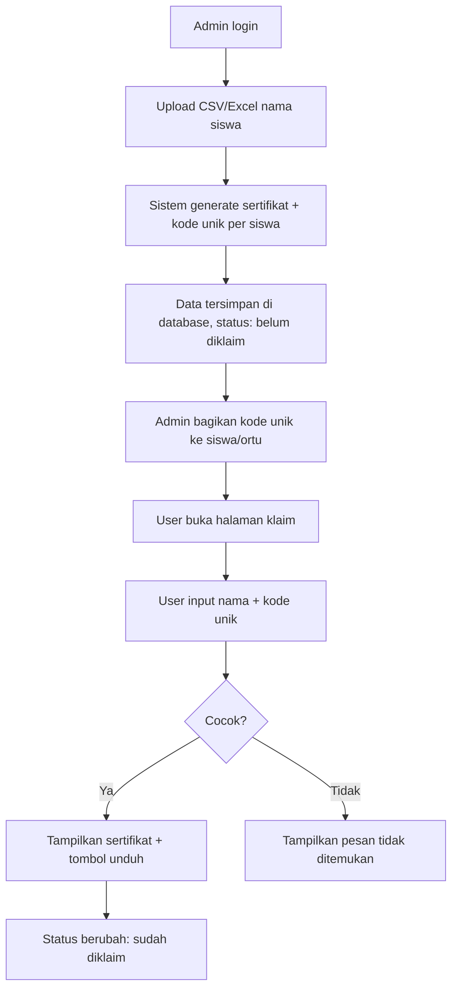

# PRD — Web Sertifikat Bimbel Anak

**Versi:** 1.0 (MVP)
**Tanggal:** 27 September 2026
**Status:** Draft

---

## 1. Ringkasan Produk

Web aplikasi untuk penerbitan dan klaim sertifikat digital bagi siswa bimbingan belajar (bimbel) anak-anak. Admin bisa memasukkan data nama siswa secara **massal** (bulk), sistem otomatis membuat sertifikat untuk tiap nama, dan siswa/orang tua bisa **klaim & unduh** sertifikat mereka sendiri lewat halaman user.

Tahap lanjutan (Fase 2): setiap sertifikat yang diklaim akan dicatat/di-mint ke **blockchain Ethereum Sepolia (testnet)** sebagai bukti keaslian yang tidak bisa diubah.

---

## 2. Latar Belakang & Masalah

- Proses pembuatan sertifikat manual (edit satu-satu di Word/Canva) memakan waktu lama saat jumlah siswa banyak.
- Tidak ada cara mudah bagi siswa/orang tua untuk mengambil sertifikat sendiri tanpa harus menghubungi admin satu per satu.
- Belum ada mekanisme verifikasi keaslian sertifikat (mudah dipalsukan).

## 3. Tujuan

1. Admin dapat membuat sertifikat untuk puluhan–ribuan siswa sekaligus (bulk generation) dalam hitungan menit.
2. Siswa dapat mencari & mengklaim sertifikat miliknya sendiri secara mandiri (self-service).
3. Desain menarik untuk anak-anak namun tetap modern (gaya **neo-brutalism** dengan sentuhan playful).
4. Sistem berjalan di infrastruktur **gratis** (Vercel + database gratis) untuk MVP.
5. Menyiapkan fondasi agar ke depan sertifikat bisa diverifikasi lewat **blockchain Sepolia**.

## 4. Ruang Lingkup

### Termasuk (MVP — Fase 1)
- Login admin
- Upload data siswa secara massal (CSV/Excel atau input manual banyak baris)
- Generate sertifikat otomatis dari 1 template ke banyak nama
- Halaman klaim sertifikat untuk user (cari by nama/kode unik)
- Unduh sertifikat dalam format PDF/gambar
- Dashboard admin: lihat status (belum diklaim / sudah diklaim)

### Tidak termasuk di Fase 1 (masuk Fase 2)
- Integrasi blockchain Ethereum Sepolia (minting NFT/hash on-chain)
- Wallet connect (MetaMask)
- Multi-tenant (banyak bimbel dalam satu sistem)
- Multi-template dinamis dari UI (drag & drop editor)

---

## 5. Persona Pengguna

| Persona | Deskripsi | Kebutuhan Utama |
|---|---|---|
| **Admin (staf bimbel)** | Mengelola data siswa & sertifikat | Upload cepat, generate massal, pantau status klaim |
| **User (siswa/orang tua)** | Menerima info lulus/selesai kelas | Klaim sertifikat sendiri, mudah & cepat, tampilan menarik untuk anak |

---

## 6. Fitur & User Stories

### 6.1 Fitur Admin

| # | Fitur | User Story |
|---|---|---|
| A1 | Login Admin | Sebagai admin, saya ingin login agar hanya saya yang bisa mengelola data. |
| A2 | Upload Massal Nama Siswa | Sebagai admin, saya ingin upload file CSV/Excel berisi banyak nama siswa sekaligus, agar tidak input satu-satu. |
| A3 | Input Manual (opsional) | Sebagai admin, saya ingin bisa menambah/edit satu nama secara manual untuk koreksi data. |
| A4 | Generate Sertifikat Massal | Sebagai admin, setelah data diupload saya ingin sistem otomatis membuat sertifikat + kode unik untuk tiap siswa. |
| A5 | Kelola Template Sertifikat | Sebagai admin, saya ingin memilih/mengganti desain template sertifikat yang dipakai. |
| A6 | Lihat Status Klaim | Sebagai admin, saya ingin melihat siapa saja yang sudah/belum klaim sertifikatnya. |
| A7 | Export Data | Sebagai admin, saya ingin export daftar sertifikat & kode unik (untuk dibagikan lewat WA/grup jika perlu). |

### 6.2 Fitur User

| # | Fitur | User Story |
|---|---|---|
| U1 | Cari Sertifikat | Sebagai siswa/orang tua, saya ingin mencari sertifikat saya dengan memasukkan nama + kode unik/ID yang diberikan bimbel. |
| U2 | Klaim Sertifikat | Sebagai siswa, saya ingin menekan tombol "Klaim" agar sertifikat tercatat sudah saya ambil. |
| U3 | Unduh Sertifikat | Sebagai siswa, saya ingin mengunduh sertifikat dalam bentuk PDF/gambar. |
| U4 | Halaman Verifikasi (opsional Fase 1) | Sebagai siapa saja, saya ingin memasukkan kode sertifikat untuk mengecek keasliannya. |

> **Catatan keamanan:** karena data adalah anak-anak, klaim sebaiknya tidak hanya pakai "nama" (mudah ditebak/duplikat), tapi **nama + kode unik** yang diberikan admin per siswa (lewat kertas/WA ke orang tua), supaya sertifikat orang lain tidak bisa diklaim sembarangan.

---

## 7. Alur Sistem (Flow)

---

## 8. Desain / UX

**Arahan gaya:** Neo-Brutalism + Kids-Friendly
- Border tebal (2–4px, hitam solid), hard shadow (offset shadow, bukan blur), warna blok solid kontras tinggi.
- Palet warna: kombinasi warna brutalism khas (kuning, hitam, putih) dipadu warna ceria anak-anak (biru langit, merah muda, hijau mint, oranye) — jangan terlalu pastel supaya tetap terasa "brutalist", tapi jangan terlalu gelap supaya tetap ramah anak.
- Tipografi: font tebal/chunky untuk judul (contoh gaya: Space Grotesk, Archivo Black), font yang tetap mudah dibaca untuk isi.
- Elemen playful: ilustrasi sederhana (bintang, piala, confetti, karakter maskot lucu), tombol besar dengan efek "tekan" (translate saat diklik, khas brutalism).
- Sertifikat itu sendiri (hasil akhir PDF) tetap didesain lebih formal/elegan agar pantas dipajang orang tua, sedangkan **web/dashboard-nya** yang bergaya brutalism-playful.

---

## 9. Rekomendasi Arsitektur Teknis

| Komponen | Rekomendasi | Alasan |
|---|---|---|
| Frontend + Backend | **Next.js** (App Router) | 1 codebase, deploy gratis & mudah di Vercel, API routes jadi backend serverless |
| Hosting | **Vercel (Free/Hobby plan)** | Sesuai request, auto-deploy dari GitHub |
| Database | **Supabase (PostgreSQL, free tier)** | Gratis ±500MB, sudah termasuk Auth & Storage, mudah dipakai dengan Next.js |
| Alternatif DB | Neon (Postgres serverless) atau Turso (SQLite edge) | Jika ingin coba opsi lain, keduanya juga punya tier gratis yang layak |
| Penyimpanan file template/gambar | Supabase Storage atau Cloudinary (free tier) | Untuk simpan template sertifikat & hasil generate |
| Generate PDF sertifikat | `pdf-lib` atau `@react-pdf/renderer` | Ringan, jalan baik di serverless function Vercel (hindari Puppeteer karena berat untuk free tier) |
| Autentikasi Admin | NextAuth.js (credentials) atau Supabase Auth | Gratis, cukup untuk 1 role admin |
| Import Excel/CSV | Library `xlsx` / `papaparse` di sisi server | Parsing file upload jadi data siswa |

### Perkiraan Skema Database (sederhana)

**Table: students**
| Field | Tipe |
|---|---|
| id | uuid |
| name | text |
| unique_code | text (unik, untuk klaim) |
| batch_id | text (angkatan/kelas) |
| status | enum: `unclaimed`, `claimed` |
| claimed_at | timestamp (nullable) |
| certificate_url | text |
| created_at | timestamp |

**Table: admins**
| Field | Tipe |
|---|---|
| id | uuid |
| email | text |
| password_hash | text |

**Table: certificate_templates** (opsional untuk Fase 1, wajib jika multi-template)
| Field | Tipe |
|---|---|
| id | uuid |
| name | text |
| file_url | text |

---

## 10. Rencana Fase 2 — Integrasi Blockchain (Ethereum Sepolia)

Tujuan: menjadikan sertifikat yang sudah diklaim **terverifikasi on-chain** agar tidak bisa dipalsukan/diubah.

**Rencana teknis singkat:**
1. Buat smart contract sederhana (ERC-721 atau hanya penyimpanan hash) di **Sepolia testnet** menggunakan Solidity + Hardhat/Foundry.
2. Saat user klaim sertifikat, backend menghitung **hash** dari data sertifikat (nama, kode, tanggal) lalu mengirim transaksi ke smart contract (via ethers.js/viem, menggunakan wallet admin/relayer — **user tidak perlu punya wallet sendiri** agar tetap ramah anak).
3. Simpan `transaction_hash` & `token_id` (jika NFT) di database, tampilkan di halaman sertifikat sebagai bukti "Terverifikasi di Blockchain" + link ke Sepolia Etherscan.
4. (Opsional lanjutan) User yang ingin bisa connect wallet sendiri (MetaMask) untuk melihat NFT sertifikatnya.

> Fase ini sengaja ditunda dari MVP karena butuh biaya gas (meski di testnet gratis, tetap perlu setup wallet & RPC provider seperti Alchemy/Infura) dan kompleksitas tambahan. Struktur database di atas sudah disiapkan agar mudah ditambah kolom `tx_hash` nanti.

---

## 11. Kebutuhan Non-Fungsional

- **Keamanan:** klaim sertifikat wajib pakai kode unik (bukan cuma nama) agar tidak sembarang orang bisa klaim sertifikat siswa lain.
- **Performa:** proses generate massal untuk ±1000 nama sebaiknya berjalan sebagai background job/batch, bukan generate semua PDF secara real-time saat request (agar tidak timeout di Vercel serverless, yang punya batas waktu eksekusi).
- **Skalabilitas:** perhatikan limit free tier (Supabase 500MB storage, Vercel execution time ±10 detik per function di plan gratis) — desain proses upload harus toleran terhadap batas ini (misal proses per-batch kecil).
- **Kompatibilitas:** tampilan responsif untuk HP, karena orang tua besar kemungkinan akses lewat ponsel.

---

## 12. Metrik Keberhasilan

- % siswa yang berhasil klaim sertifikat tanpa bantuan admin.
- Waktu admin generate sertifikat untuk 100+ siswa (target: di bawah 5 menit).
- Jumlah error/klaim gagal (target: mendekati 0%).

---

## 13. Roadmap Ringkas

| Fase | Fokus |
|---|---|
| Fase 1 (MVP) | Login admin, upload massal, generate sertifikat, klaim user, unduh PDF |
| Fase 1.5 | Halaman verifikasi publik by kode, notifikasi WA (opsional) |
| Fase 2 | Integrasi Ethereum Sepolia (hash/NFT sertifikat) |
| Fase 3 | Multi-tenant (banyak bimbel), editor template drag & drop |

---

## 14. Risiko & Mitigasi

| Risiko | Mitigasi |
|---|---|
| Limit free tier database/hosting terlampaui saat data besar | Batasi ukuran per batch upload, kompres/optimalkan penyimpanan file sertifikat |
| Generate PDF massal timeout di serverless | Proses secara batch/antrian (queue), bukan sekaligus semua |
| Kode unik bocor/tertukar | Kode unik acak (random), tidak berurutan/predictable |
| Kompleksitas blockchain menghambat MVP | Ditunda ke Fase 2, tidak menghambat rilis MVP |
